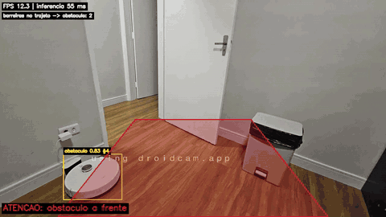
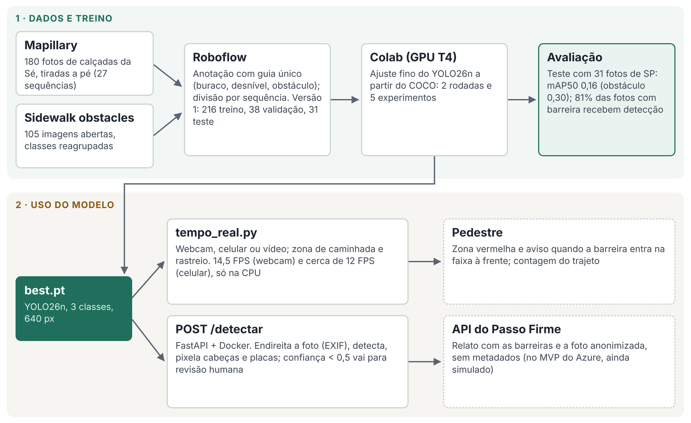
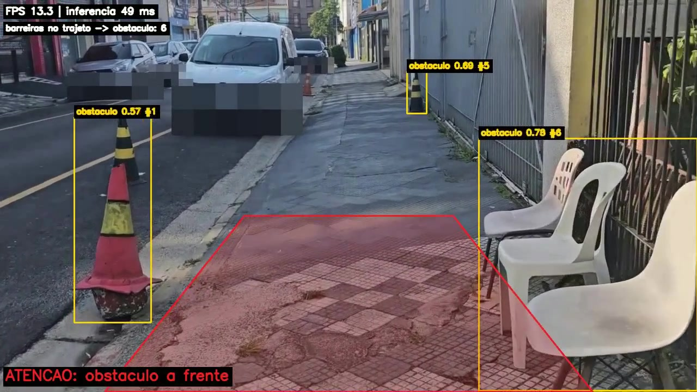
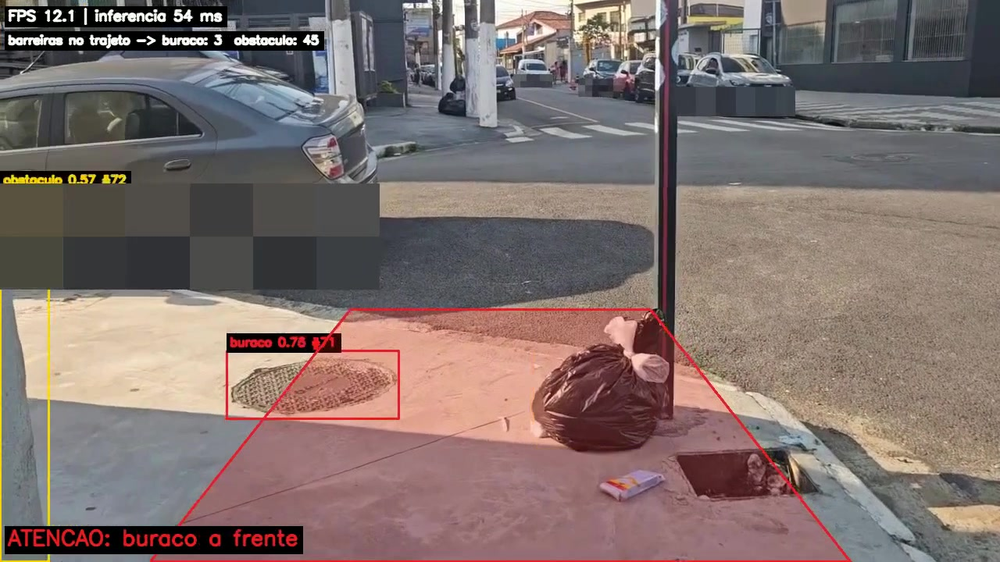
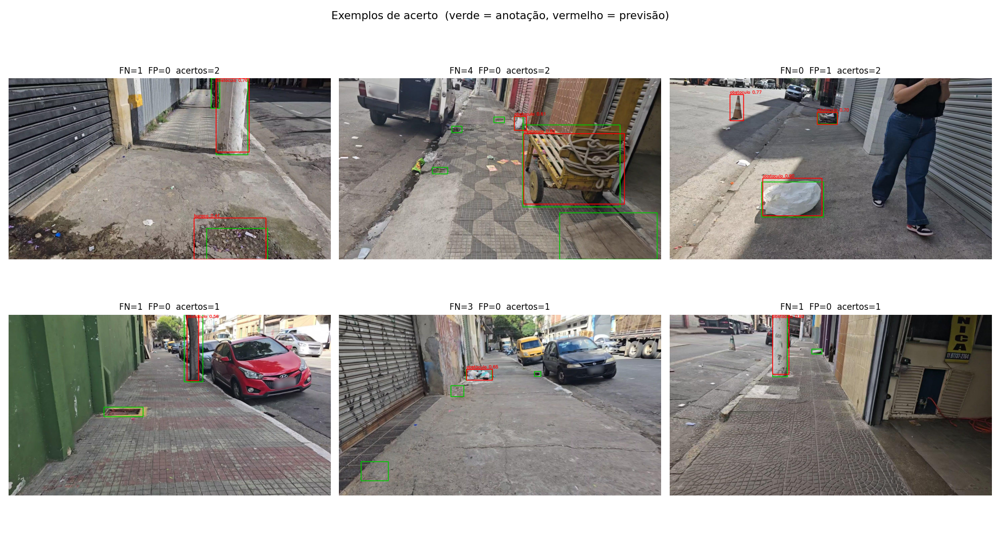
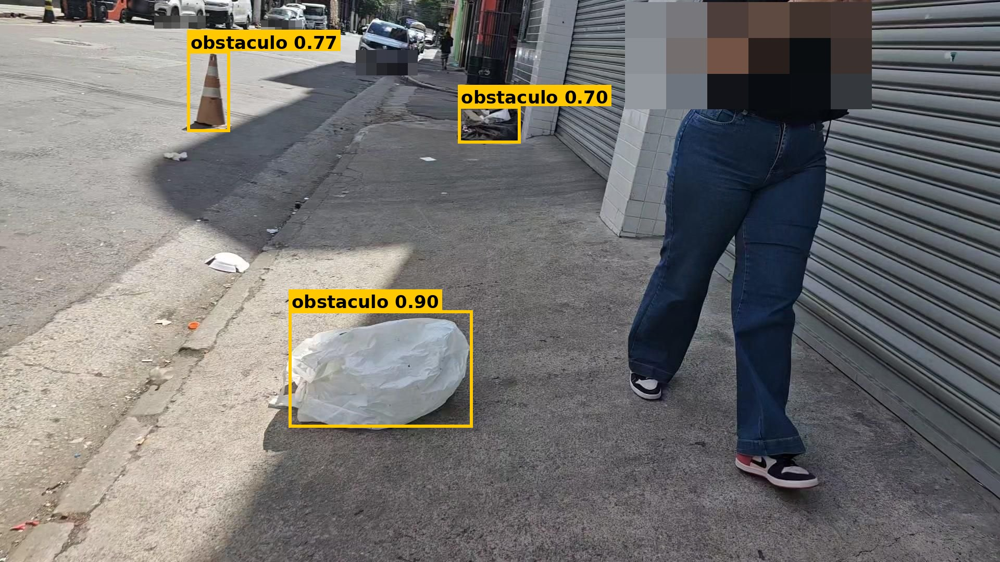

# Passo Firme — Visão Computacional

Detector de barreiras em calçadas (buraco, desnível e obstáculo) treinado sob medida com YOLO26, rodando em tempo real na CPU e empacotado como o serviço `POST /detectar` do Passo Firme.

**Global Solution 2026.2 · CitizenTech · Engenharia de Software, 4º ano (4ESPY) · Applied Computer Vision**

- **Vídeo de demonstração (2 min 41 s):** https://youtu.be/astTd2XMm9g
- **Relatório (PDF):** [`docs/relatorio.pdf`](docs/relatorio.pdf) (texto-base em [`docs/relatorio_rascunho.md`](docs/relatorio_rascunho.md))
- **Notebooks com as saídas:** [treino, rodada 1](notebooks/01_treino_yolo26_colab.ipynb) · [treino, rodada 2](notebooks/02_treino_rodada2_colab.ipynb) · [precisão e recall por limiar](notebooks/03_limiar_confianca_colab.ipynb) · [melhorias sem novos dados](notebooks/04_melhorias_sem_novos_dados_colab.ipynb)
- **Dataset no Roboflow:** https://universe.roboflow.com/pedros-workspace-md4aw/passo-firme-calcadas (versão 1, `v1-sp-blindspot`)



*Detecção ao vivo, com a câmera do celular transmitida pelo Wi-Fi para um PC sem placa de vídeo (16/11/2026).*

## Integrantes

| Nome | RM |
| --- | --- |
| David de Medeiros Pacheco Junior | RM551462 |
| Kaique Maia Reis Silva | RM552112 |
| Orlando Akio Morii Cardoso | RM98067 |
| Pedro Henrique Alves Guariente | RM550301 |

## Ficha Técnica do MVP

| Campo | Conteúdo |
| --- | --- |
| Nome do produto | Passo Firme |
| Cidadão e território | Idosos, pessoas com deficiência e pedestres que dependem de andar a pé, num distrito piloto de São Paulo |
| Problema, em uma frase | Buracos, degraus e obstáculos nas calçadas derrubam e isolam justamente quem mais depende delas, e ninguém tem a visão do todo para priorizar o conserto |
| Proposta de valor | Para o cidadão, de graça: fotografou, a IA identifica a barreira, explica quem é o responsável pela lei e encaminha. Para quem conserta: mapa priorizado por risco e população afetada, com prova em foto |
| Arquitetura: componentes | App web acessível (planejado; no MVP atual, a entrada é a API) · API FastAPI + PostgreSQL · **detector YOLO (este repositório)** · assistente da lei (LLM local + RAG) · pipeline Airflow → Databricks · robô de triagem (RPA) · robô vistoriador (Maker Lab) · containers no Azure com Terraform e GitHub Actions |
| Fontes de dados | SP156 (dados abertos da Prefeitura) · Open-Meteo (chuva) · API do IBGE (população) · relatos dos cidadãos (foto + GPS) · leituras do robô · **imagens de calçadas de São Paulo do Mapillary e o dataset aberto *Sidewalk obstacles* (este repositório)** · Lei 15.442/2011, Decreto 59.671/2020, Lei 13.146/2015 e Carta de Serviços do SP156 |
| Modelos de IA utilizados | **YOLO26n treinado para barreiras de calçada (este repositório)** · YOLO26n do COCO para anonimizar pessoas e placas · LLM aberto pequeno com RAG e LoRA · embeddings multilíngues · TinyML no robô |
| URL do MVP e repositório | MVP: https://ca-passofirme-api.lemonfield-b3da2f2c.brazilsouth.azurecontainerapps.io/docs · repositório principal: https://github.com/predowss/passo-firme · este repositório: https://github.com/predowss/passo-firme-visao |
| Indicadores de impacto | Barreiras mapeadas · % resolvidas · tempo médio até o conserto (antes, pelo histórico do SP156, e depois) · idosos e pessoas com deficiência usando o Passo Firme · metros de calçada vistoriados pelo robô |
| ODS conectados | 11 (metas 11.2 e 11.7) · 10 (meta 10.2) · 3 · 9 (meta 9.1) |

## O papel da visão no Passo Firme

O componente de visão enxerga a calçada e transforma o que vê em informação: tipo, posição e confiança de cada barreira. As imagens chegam por três caminhos, todos testados:

| Entrada | Como funciona | Código |
| --- | --- | --- |
| Câmera ao vivo | Webcam do PC ou câmera do celular pelo Wi-Fi (DroidCam). Detecção em tempo real, a 12–14 FPS, com zona de alerta à frente do pedestre e contagem das barreiras do trajeto | `src/tempo_real.py` |
| Vídeo gravado | Uma caminhada filmada é processada quadro a quadro pelo mesmo script, como a do Centro de Osasco | `src/tempo_real.py --fonte video.mp4` |
| Foto | `POST /detectar` recebe a foto, endireita pela orientação do EXIF e devolve as barreiras em JSON (classe, confiança e caixa, os campos da tabela `deteccao` do MVP) e a foto sem metadados, com rostos e placas pixelados. Sem detecção ou abaixo de 0,5 de confiança, vai para revisão humana | `src/api.py` |

No desenho do Passo Firme, a foto do cidadão chega à API do MVP (`POST /relatos`), que chama o `/detectar`. **Situação da integração:** este repositório entrega o serviço pronto, com Dockerfile; no MVP publicado no Azure, a rota `/detectar` ainda devolve uma resposta simulada no mesmo formato, e ligar o detector real é publicar este container e apontar a API do MVP para ele.



## Dados e treino

- **Dataset (285 imagens, 3 classes: `buraco`, `desnivel` e `obstaculo`):** 180 fotos de calçadas da Sé, em São Paulo, baixadas do Mapillary só de sequências capturadas a pé e anotadas pelo grupo no Roboflow com um guia único ([`docs/guia_de_anotacao.md`](docs/guia_de_anotacao.md)), mais 105 imagens do dataset aberto *Sidewalk obstacles*, com as classes reagrupadas.
- **Divisão sem vazamento:** sequências inteiras do Mapillary ficam só no treino e validação ou só no teste; o teste tem apenas fotos de São Paulo (31 imagens, 71 barreiras).
- **Treino:** ajuste fino do YOLO26n a partir dos pesos do COCO, no Google Colab (GPU T4), em 640 px, com até 80 épocas, parada antecipada e o aumento de dados do Ultralytics.
- **Experimentos:** duas rodadas de treino (nano × small, 640 × 960 px, 3 × 2 classes, validação mista × só de São Paulo) e quatro melhorias sem fotos novas (notebook 04). O modelo final é o YOLO26n de 3 classes em 640 px, o mais estável ao vivo.
- **Ferramentas:** Python, Ultralytics YOLO26, Roboflow, API do Mapillary, Google Colab, OpenCV, rastreamento BoT-SORT, FastAPI e Docker.

## Resultados

**O que funciona:**
- **Obstáculos, o ponto forte:** mAP50 de 0,30 no teste e detecções de 0,85 a 0,90 ao vivo (lixeira, robô aspirador).
- **Na rua, numa cidade fora do treino:** no Centro de Osasco, o modelo marcou cones, cadeiras, sacos de lixo, vasos e postes no caminho, com a zona de alerta acionada.
- **Por foto:** 81% das fotos de teste com barreira recebem ao menos uma detecção; com recortes no `/detectar`, todas as 26.
- **Tempo real sem placa de vídeo:** 12 a 14 FPS num PC comum.
- **Serviço pronto para plugar no MVP:** `/detectar` com Dockerfile, anonimização de rostos e placas e revisão humana dos casos incertos.

Modelo final: YOLO26n, 3 classes, 640 px. Conjunto de teste com 31 fotos de calçadas de São Paulo, de sequências que o modelo nunca viu.

| Métrica (teste, 31 imagens de SP) | Valor |
| --- | ---: |
| mAP50 | 0,16 |
| mAP50-95 | 0,08 |
| Precisão | 0,48 |
| Recall | 0,14 |
| Velocidade num PC de mesa sem placa de vídeo (AMD Ryzen 5 2600) | 14,5 FPS com a webcam · cerca de 12 FPS com a câmera do celular pelo Wi-Fi |

| Classe | Precisão | Recall | mAP50 |
| --- | ---: | ---: | ---: |
| obstaculo | 0,57 | 0,28 | 0,30 |
| desnivel | 0,59 | 0,10 | 0,12 |
| buraco | 0,27 | 0,04 | 0,06 |

Precisão e recall da tabela são medidos no limiar de confiança que maximiza o F1. Em limiares fixos (`notebooks/03_limiar_confianca_colab.ipynb`, tabela completa em `resultados/limiares.csv`):

| Confiança mínima | Precisão | Recall | Fotos com barreira com ao menos uma detecção | Fotos sem barreira com alarme falso |
| ---: | ---: | ---: | ---: | ---: |
| 0,10 | 0,24 | 0,25 | 25 de 26 (96%) | 3 de 5 |
| 0,25 (serviço) | 0,35 | 0,21 | 21 de 26 (81%) | 2 de 5 |
| 0,35 (tempo real) | 0,43 | 0,17 | 16 de 26 (62%) | 2 de 5 |
| 0,50 | 0,65 | 0,15 | 11 de 26 (42%) | 1 de 5 |

Precisão e recall por caixa com IoU de 0,5. Com o limiar de 0,25 do serviço, 4 em cada 5 fotos com barreira chegam com pelo menos uma barreira marcada; as fotos sem nenhuma detecção vão para revisão humana, em vez de se perderem.

**Dados locais fazem diferença:** um modelo igual acerta mAP50 de 0,89 em 16 imagens do dataset aberto que não viu e só 0,11 nas ruas de São Paulo.

**Melhorias sem anotar fotos novas** (`notebooks/04_melhorias_sem_novos_dados_colab.ipynb`, tabela em `resultados/melhorias.csv`), no mesmo teste e com a mesma conta para todos:

| Experimento | mAP50 | Precisão (0,25) | Recall (0,25) | Fotos com barreira com ao menos uma detecção | ms por foto (GPU T4) |
| --- | ---: | ---: | ---: | ---: | ---: |
| E0 modelo final, 640 px | 0,175 | 0,349 | 0,211 | 21 de 26 | 513* |
| E1 inferência em 960 px | 0,131 | 0,261 | 0,169 | 20 de 26 | 26 |
| E2 inferência em 1280 px | 0,115 | 0,209 | 0,127 | 21 de 26 | 30 |
| E3 recortes 2×2 + foto inteira | **0,204** | 0,245 | **0,324** | **26 de 26** | 72 |
| E4 treino + validação juntos | 0,157 | 0,312 | 0,141 | 20 de 26 | 26 |
| E5 E4 + recortes | 0,113 | 0,158 | 0,169 | 23 de 26 | 73 |

\* Inclui o aquecimento da GPU na primeira chamada; o E4, com um modelo do mesmo tamanho, levou 26 ms.

**Os recortes foram o ganho:** recall de 0,21 para 0,32 e todas as 26 fotos com barreira com ao menos uma detecção, sem mais alarmes falsos nas fotos sem barreira. Custam cerca de 3 vezes o tempo e alguma precisão, por isso viraram uma opção do `/detectar` (`recortes=true`) e ficaram fora do tempo real. Ler a foto maior e treinar com a validação junto não ajudaram: o próximo ganho virá de mais dados. O E0 reproduz o notebook 03 (seu mAP50 de 0,175 difere do 0,159 do Ultralytics por detalhes da conta).

**Na rua (17/11).** Uma caminhada de 3 minutos no Centro de Osasco, na Grande São Paulo (cidade fora do treino, que só tem fotos da Sé), filmada com o celular e processada no PC, quadro a quadro, a 12 ou 13 FPS: o modelo marcou cones, cadeiras de plástico, sacos de lixo, vasos e postes no caminho, e a zona ficou vermelha quando eles entraram na faixa à frente. O erro mais visível foi uma tampa de bueiro tomada por buraco (à direita).

<p> </p>



Detalhes por rodada, comparação nano × small, resolução 640 × 960, 3 × 2 classes e análise dos piores casos estão no relatório e nos notebooks.

## Como reproduzir

Os comandos usam `python`; no Windows, use `py`. Testado com Python 3.14 no Windows (PC do grupo, AMD Ryzen 5 2600, sem placa de vídeo) e com Python 3.13 e Ultralytics 8.4.214 no Colab.

### 1. Dataset

As imagens de São Paulo vêm do Mapillary, filtradas para sequências capturadas a pé e separadas por bairro:

```bash
set "MAPILLARY_TOKEN=MLY|..."          # Windows (cmd); no Linux/Mac: export MAPILLARY_TOKEN='MLY|...'
python scripts/baixar_mapillary.py --regiao se
```

Quando o bairro só tem sequências gravadas de carro, `--listar` mostra as mais lentas e `--sequencia "bairro=CHAVE"` baixa as escolhidas a dedo (detalhes no guia de anotação). Completam o dataset 105 imagens do dataset aberto *Sidewalk obstacles* (Blindspot), clonadas no Roboflow com as classes reagrupadas em `obstaculo`.

Depois, siga `docs/guia_de_anotacao.md` (classes, revisão das imagens, anotação e divisão por sequência). O dataset final está no Roboflow; os notebooks baixam a versão usada.

### 2. Treino (Google Colab, GPU T4)

Abra `notebooks/01_treino_yolo26_colab.ipynb` no Colab, crie o segredo `ROBOFLOW_API_KEY` (painel de chave à esquerda, com acesso liberado para o notebook), confira workspace, projeto e versão e use *Executar tudo*. Ao fim, o notebook baixa o `best.pt`; coloque-o em `modelos/`. O `notebooks/02_treino_rodada2_colab.ipynb` repete o treino com a validação só de São Paulo e a variante de 2 classes. Os notebooks 03 e 04 baixam o `best.pt` deste repositório e medem, no mesmo teste, os limiares de confiança e as melhorias sem fotos novas.

### 3. Tempo real (no seu computador)

```bash
python -m venv .venv
source .venv/bin/activate          # Windows: .venv\Scripts\activate
pip install -r requirements.txt

# webcam
python src/tempo_real.py --modelo modelos/best.pt --fonte 0 --rastrear
# câmera do celular pelo Wi-Fi (ex.: app DroidCam, mesma rede)
python src/tempo_real.py --modelo modelos/best.pt --fonte http://IP-DO-CELULAR:4747/video --rastrear
# vídeo gravado, salvando o resultado anotado
python src/tempo_real.py --modelo modelos/best.pt --fonte caminhada.mp4 --rastrear --salvar resultados/demo.mp4
```

Tecla `q` encerra; o script imprime o FPS médio e a contagem de barreiras do trajeto. Em câmera ao vivo, uma thread lê a câmera o tempo todo e o modelo sempre recebe o quadro mais recente, então o atraso não cresce mesmo quando o modelo é mais lento que a câmera; com `--salvar`, o vídeo ao vivo é gravado com o FPS medido, para tocar na velocidade real. Antes de publicar um vídeo, pixele cabeças e placas:

```bash
python scripts/anonimizar_video.py resultados/demo.mp4 resultados/demo_anonimo.mp4
```

### 4. Serviço `/detectar`

```bash
pip install -r requirements-api.txt
uvicorn src.api:app --port 8001        # documentação em http://localhost:8001/docs

# ou com Docker
docker build -t passo-firme-visao .
docker run --rm -p 8001:8001 passo-firme-visao
```

Exemplo de chamada:

```bash
curl -F "foto=@calcada.jpg" "http://localhost:8001/detectar?devolver_imagem=false"
```

Resposta real para a foto `sp_se_1542016304509302.jpg` do teste (saco de lixo, cone e monte de lixo na calçada):

```json
{
  "id": "a426609b-a27e-4024-a2e7-fc70d5e6ead5",
  "largura": 1920, "altura": 1080,
  "deteccoes": [
    {"classe": "obstaculo", "confianca": 0.897, "caixa": [554, 596.4, 907.5, 821.1]},
    {"classe": "obstaculo", "confianca": 0.771, "caixa": [359.6, 97.7, 441.1, 253.8]},
    {"classe": "obstaculo", "confianca": 0.699, "caixa": [879.3, 203.4, 999.2, 275.2]}
  ],
  "total": 3,
  "revisao_humana": false,
  "anonimizacao": {"cabecas": 1, "placas": 3, "rostos": 0, "metodos": ["yolo_coco", "haar_rosto"]},
  "modelo": "best.pt",
  "tempo_ms": 2064
}
```

A primeira chamada leva alguns segundos porque carrega os modelos; as seguintes são mais rápidas. Com `devolver_imagem=true`, a resposta traz também a foto anonimizada em base64. Com `recortes=true`, o detector lê também quatro pedaços da foto e junta as caixas: no teste, o recall subiu de 0,21 para 0,32 e a precisão caiu de 0,35 para 0,25 (notebook 04). Vem desligado para manter a resposta acima:

```bash
curl -F "foto=@calcada.jpg" "http://localhost:8001/detectar?devolver_imagem=false&recortes=true"
```



### 5. Avaliação por grupo de imagens (opcional, fora do Colab)

```bash
python scripts/contar_classes.py dados/<dataset>/data.yaml
python scripts/avaliar_por_regiao.py --modelo modelos/best.pt --dados dados/<dataset>/data.yaml \
    --grupo centro=sp_se,sp_paulista --grupo periferia=sp_periferia
```

## Estrutura

```
├── notebooks/
│   ├── 01_treino_yolo26_colab.ipynb   rodada 1: treino, avaliação e figuras (com saídas)
│   ├── 02_treino_rodada2_colab.ipynb  rodada 2: validação só de SP, 2 classes (com saídas)
│   ├── 03_limiar_confianca_colab.ipynb precisão e recall por limiar e por foto (com saídas)
│   └── 04_melhorias_sem_novos_dados_colab.ipynb resolução, recortes e treino + validação (com saídas)
├── src/
│   ├── tempo_real.py      detecção ao vivo com zona de alerta, FPS e contagem
│   ├── api.py             serviço POST /detectar (FastAPI)
│   └── anonimizar.py      pixela cabeças e placas (LGPD)
├── scripts/
│   ├── baixar_mapillary.py    imagens de SP por bairro, só sequências a pé, com créditos
│   ├── contar_classes.py      tabela do dataset por classe e conjunto
│   ├── avaliar_por_regiao.py  métricas por grupo de imagens (bairros, SP × aberto)
│   └── anonimizar_video.py    pixela cabeças e placas de um vídeo inteiro antes de publicar
├── docs/
│   ├── relatorio_rascunho.md  texto-base do PDF
│   ├── guia_de_anotacao.md    regras de coleta, anotação e divisão
│   └── roteiro_video.md       roteiro e checklist do vídeo
├── dados/      README com links, licenças e créditos dos datasets
├── modelos/    best.pt treinado
├── resultados/ figuras do relatório, GIF do tempo real, tabelas de limiares e de melhorias
├── Dockerfile
└── requirements.txt / requirements-api.txt
```

## Dados, licenças e privacidade

- Dataset aberto *Sidewalk obstacles* (Blindspot), do Roboflow Universe, CC BY 4.0, com link e mapeamento das classes em `dados/README.md`.
- Imagens de calçadas de São Paulo do [Mapillary](https://www.mapillary.com), licença CC BY-SA 4.0, capturadas a pé e já com rostos e placas borrados pela plataforma. Autor e link de cada imagem em `dados/creditos_mapillary.csv`.
- O dataset é uma coleção: as anotações e a documentação do grupo estão sob CC BY 4.0; as imagens do Mapillary entram sem alteração e continuam sob CC BY-SA 4.0, com os créditos acima.
- O código usa a biblioteca Ultralytics, distribuída sob AGPL-3.0; o serviço e o modelo `best.pt`, treinado com ela, seguem essa licença.
- O serviço não guarda a foto original nem registra localização ou nome de arquivo nos logs; só a cópia anonimizada sai dele, sem os metadados EXIF.
- Os vídeos e as imagens de rua gravados pelo grupo (Osasco) passaram pelo `scripts/anonimizar_video.py`, que pixela cabeças e placas, antes de entrar no repositório e no vídeo.

## Limitações e como o sistema lida com elas

| Limitação | Como o sistema lida e o próximo passo |
| --- | --- |
| Buraco e desnível com poucos exemplos (mAP50 de 0,06 e 0,12) | Revisão humana abaixo de 0,5 de confiança e recortes no `/detectar`; as fotos dos relatos, depois de revisadas, viram novos rótulos |
| Fotos de treino de uma só região (Sé), de dia | Teste separado por sequência; Osasco, fora do treino, como primeira amostra; próximo passo: outros bairros, chuva e noite |
| Teste pequeno (31 fotos) | Diferenças de poucos centésimos não são tratadas como ganho |
| Só reconhece as três classes treinadas | O que fica sem detecção vai para revisão humana; próximo passo: mais classes ou um detector de vocabulário aberto (YOLOE-26) |
