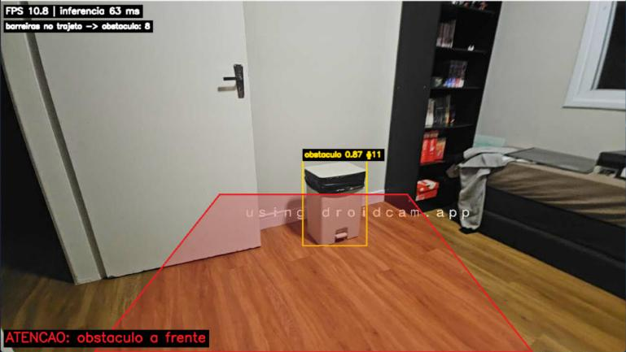

# Passo Firme — Visão Computacional

Detector de barreiras em calçadas (buraco, desnível e obstáculo) treinado sob medida com YOLO26, rodando em tempo real na CPU e empacotado como o serviço `POST /detectar` do Passo Firme.

**Global Solution 2026.2 · CitizenTech · Engenharia de Software, 4º ano (4ESPY) · Applied Computer Vision**

- **Vídeo de demonstração:** em edição; o link do YouTube (não listado) entra aqui até 19/11
- **Relatório (PDF):** [`docs/relatorio.pdf`](docs/relatorio.pdf) (texto-base em [`docs/relatorio_rascunho.md`](docs/relatorio_rascunho.md))
- **Notebooks de treino com as saídas:** [rodada 1](notebooks/01_treino_yolo26_colab.ipynb) · [rodada 2](notebooks/02_treino_rodada2_colab.ipynb)
- **Dataset no Roboflow:** https://universe.roboflow.com/pedros-workspace-md4aw/passo-firme-calcadas (versão 1, `v1-sp-blindspot`)

## Integrantes

| Nome | RM |
| --- | --- |
| David de Medeiros Pacheco Junior | RM551462 |
| Kaique Maia Reis Silva | RM552112 |
| Orlando Akio Morii Cardoso | RM98067 |
| Pedro Henrique Alves Guariente | RM550301 |

## Ficha Técnica do MVP

| Campo | Conteúdo |
| --- | --- |
| Nome do produto | Passo Firme |
| Cidadão e território | Idosos, pessoas com deficiência e pedestres que dependem de andar a pé, num distrito piloto de São Paulo |
| Problema, em uma frase | Buracos, degraus e obstáculos nas calçadas derrubam e isolam justamente quem mais depende delas, e ninguém tem a visão do todo para priorizar o conserto |
| Proposta de valor | Para o cidadão, de graça: fotografou, a IA identifica a barreira, explica quem é o responsável pela lei e encaminha. Para quem conserta: mapa priorizado por risco e população afetada, com prova em foto |
| Arquitetura: componentes | App web acessível · API FastAPI + PostgreSQL · **detector YOLO (este repositório)** · assistente da lei (LLM local + RAG) · pipeline Airflow → Databricks · robô de triagem (RPA) · robô vistoriador (Maker Lab) · containers no Azure com Terraform e GitHub Actions |
| Fontes de dados | SP156 (dados abertos da Prefeitura) · Open-Meteo (chuva) · API do IBGE (população) · relatos do app (foto + GPS) · leituras do robô · **imagens de calçadas de São Paulo do Mapillary e o dataset aberto *Sidewalk obstacles* (este repositório)** · Lei 15.442/2011, Decreto 59.671/2020, Lei 13.146/2015 e Carta de Serviços do SP156 |
| Modelos de IA utilizados | **YOLO26n treinado para barreiras de calçada (este repositório)** · YOLO26n do COCO para anonimizar pessoas e placas · LLM aberto pequeno com RAG e LoRA · embeddings multilíngues · TinyML no robô |
| URL do MVP e repositório | MVP: https://ca-passofirme-api.lemonfield-b3da2f2c.brazilsouth.azurecontainerapps.io/docs · repositório principal: https://github.com/predowss/passo-firme · este repositório: https://github.com/predowss/passo-firme-visao |
| Indicadores de impacto | Barreiras mapeadas · % resolvidas · tempo médio até o conserto (antes, pelo histórico do SP156, e depois) · idosos e pessoas com deficiência usando o app · metros de calçada vistoriados pelo robô |
| ODS conectados | 11 (metas 11.2 e 11.7) · 10 (meta 10.2) · 3 · 9 (meta 9.1) |

## O papel da visão no Passo Firme

O cidadão fotografa a calçada no app. A API principal manda a foto para `POST /detectar`, que devolve as barreiras (classe, confiança e caixa, os mesmos campos da tabela `deteccao` do banco do MVP) e a foto com cabeças e placas pixeladas. Se nada for detectado ou a maior confiança ficar abaixo de 0,5, o relato vai para revisão humana antes de ser encaminhado.

**Situação da integração:** este repositório entrega o serviço pronto, com Dockerfile. No MVP publicado no Azure, a rota `/detectar` ainda devolve uma resposta simulada no mesmo formato; ligar o detector real é publicar este container e apontar a API principal para ele.

O mesmo modelo roda em tempo real (`src/tempo_real.py`) sobre a webcam, a câmera do celular ou um vídeo gravado: uma zona em trapézio marca o chão à frente do pedestre e fica vermelha quando uma barreira entra nela.



## Resultados

Modelo final: YOLO26n, 3 classes, 640 px. Conjunto de teste com 31 fotos de calçadas de São Paulo, de sequências que o modelo nunca viu.

| Métrica (teste, 31 imagens de SP) | Valor |
| --- | ---: |
| mAP50 | 0,16 |
| mAP50-95 | 0,08 |
| Precisão | 0,48 |
| Recall | 0,14 |
| Velocidade num PC de mesa sem placa de vídeo (AMD Ryzen 5 2600) | 14,5 FPS com a webcam · cerca de 12 FPS com a câmera do celular pelo Wi-Fi |

| Classe | Precisão | Recall | mAP50 |
| --- | ---: | ---: | ---: |
| obstaculo | 0,57 | 0,28 | 0,30 |
| desnivel | 0,59 | 0,10 | 0,12 |
| buraco | 0,27 | 0,04 | 0,06 |

Precisão e recall da tabela são medidos no limiar de confiança que maximiza o F1. Na matriz de confusão (`resultados/A_teste/`), que usa confiança mínima de 0,25, a mesma do serviço, e sobreposição (IoU) de 0,45, o modelo encontra 69% dos obstáculos, 40% dos desníveis e 36% dos buracos do teste; os falsos alarmes que um limiar baixo traz vão para revisão humana.

**Dados locais fazem diferença:** um modelo igual acerta mAP50 de 0,89 em 16 imagens do dataset aberto que não viu e só 0,11 nas ruas de São Paulo.


Detalhes por rodada, comparação nano × small, resolução 640 × 960, 3 × 2 classes e análise dos piores casos estão no relatório e nos notebooks.

## Como reproduzir

Os comandos usam `python`; no Windows, use `py`.

### 1. Dataset

As imagens de São Paulo vêm do Mapillary, filtradas para sequências capturadas a pé e separadas por bairro:

```bash
set "MAPILLARY_TOKEN=MLY|..."          # Windows (cmd); no Linux/Mac: export MAPILLARY_TOKEN='MLY|...'
python scripts/baixar_mapillary.py --regiao se
```

Quando o bairro só tem sequências gravadas de carro, `--listar` mostra as mais lentas e `--sequencia "bairro=CHAVE"` baixa as escolhidas a dedo (detalhes no guia de anotação). Completam o dataset 105 imagens do dataset aberto *Sidewalk obstacles* (Blindspot), clonadas no Roboflow com as classes reagrupadas em `obstaculo`.

Depois, siga `docs/guia_de_anotacao.md` (classes, revisão das imagens, anotação e divisão por sequência). O dataset final está no Roboflow; os notebooks baixam a versão usada.

### 2. Treino (Google Colab, GPU T4)

Abra `notebooks/01_treino_yolo26_colab.ipynb` no Colab, crie o segredo `ROBOFLOW_API_KEY` (painel de chave à esquerda, com acesso liberado para o notebook), confira workspace, projeto e versão e use *Executar tudo*. Ao fim, o notebook baixa o `best.pt`; coloque-o em `modelos/`. O `notebooks/02_treino_rodada2_colab.ipynb` repete o treino com a validação só de São Paulo e a variante de 2 classes.

### 3. Tempo real (no seu computador)

```bash
python -m venv .venv
source .venv/bin/activate          # Windows: .venv\Scripts\activate
pip install -r requirements.txt

# webcam
python src/tempo_real.py --modelo modelos/best.pt --fonte 0 --rastrear
# câmera do celular pelo Wi-Fi (ex.: app DroidCam, mesma rede)
python src/tempo_real.py --modelo modelos/best.pt --fonte http://IP-DO-CELULAR:4747/video --rastrear
# vídeo gravado, salvando o resultado anotado
python src/tempo_real.py --modelo modelos/best.pt --fonte caminhada.mp4 --rastrear --salvar resultados/demo.mp4
```

Tecla `q` encerra; o script imprime o FPS médio e a contagem de barreiras do trajeto. Antes de publicar um vídeo, pixele cabeças e placas:

```bash
python scripts/anonimizar_video.py resultados/demo.mp4 resultados/demo_anonimo.mp4
```

### 4. Serviço `/detectar`

```bash
pip install -r requirements-api.txt
uvicorn src.api:app --port 8001        # documentação em http://localhost:8001/docs

# ou com Docker
docker build -t passo-firme-visao .
docker run --rm -p 8001:8001 passo-firme-visao
```

Exemplo de chamada:

```bash
curl -F "foto=@calcada.jpg" "http://localhost:8001/detectar?devolver_imagem=false"
```

Resposta real para a foto `sp_se_1542016304509302.jpg` do teste (saco de lixo, cone e monte de lixo na calçada):

```json
{
  "id": "a426609b-a27e-4024-a2e7-fc70d5e6ead5",
  "largura": 1920, "altura": 1080,
  "deteccoes": [
    {"classe": "obstaculo", "confianca": 0.897, "caixa": [554, 596.4, 907.5, 821.1]},
    {"classe": "obstaculo", "confianca": 0.771, "caixa": [359.6, 97.7, 441.1, 253.8]},
    {"classe": "obstaculo", "confianca": 0.699, "caixa": [879.3, 203.4, 999.2, 275.2]}
  ],
  "total": 3,
  "revisao_humana": false,
  "anonimizacao": {"cabecas": 1, "placas": 3, "rostos": 0, "metodos": ["yolo_coco", "haar_rosto"]},
  "modelo": "best.pt",
  "tempo_ms": 2064
}
```

A primeira chamada leva cerca de 2 s porque carrega os modelos; as seguintes são mais rápidas. Com `devolver_imagem=true`, a resposta traz também a foto anonimizada em base64.


### 5. Avaliação por grupo de imagens (opcional, fora do Colab)

```bash
python scripts/contar_classes.py dados/<dataset>/data.yaml
python scripts/avaliar_por_regiao.py --modelo modelos/best.pt --dados dados/<dataset>/data.yaml \
    --grupo centro=sp_se,sp_paulista --grupo periferia=sp_periferia
```

## Estrutura

```
├── notebooks/
│   ├── 01_treino_yolo26_colab.ipynb   rodada 1: treino, avaliação e figuras (com saídas)
│   └── 02_treino_rodada2_colab.ipynb  rodada 2: validação só de SP, 2 classes (com saídas)
├── src/
│   ├── tempo_real.py      detecção ao vivo com zona de alerta, FPS e contagem
│   ├── api.py             serviço POST /detectar (FastAPI)
│   └── anonimizar.py      pixela cabeças e placas (LGPD)
├── scripts/
│   ├── baixar_mapillary.py    imagens de SP por bairro, só sequências a pé, com créditos
│   ├── contar_classes.py      tabela do dataset por classe e conjunto
│   ├── avaliar_por_regiao.py  métricas por grupo de imagens (bairros, SP × aberto)
│   └── anonimizar_video.py    pixela cabeças e placas de um vídeo inteiro antes de publicar
├── docs/
│   ├── relatorio_rascunho.md  texto-base do PDF
│   ├── guia_de_anotacao.md    regras de coleta, anotação e divisão
│   └── roteiro_video.md       roteiro e checklist do vídeo
├── dados/      README com links, licenças e créditos dos datasets
├── modelos/    best.pt treinado
├── resultados/ figuras do relatório
├── Dockerfile
└── requirements.txt / requirements-api.txt
```

## Dados, licenças e privacidade

- Dataset aberto *Sidewalk obstacles* (Blindspot), do Roboflow Universe, CC BY 4.0, com link e mapeamento das classes em `dados/README.md`.
- Imagens de calçadas de São Paulo do [Mapillary](https://www.mapillary.com), licença CC BY-SA 4.0, capturadas a pé e já com rostos e placas borrados pela plataforma. Autor e link de cada imagem em `dados/creditos_mapillary.csv`.
- O dataset é uma coleção: as anotações e o código do grupo estão sob CC BY 4.0; as imagens do Mapillary entram sem alteração e continuam sob CC BY-SA 4.0, com os créditos acima.
- O serviço não guarda a foto original nem registra localização ou nome de arquivo nos logs; só a cópia anonimizada sai dele.

## Limitações

- **Buraco e desnível ainda não foram aprendidos** (mAP50 de 0,06 e 0,12): são formas irregulares, com cerca de 110 exemplos no treino, e juntar as duas classes não ajudou. Obstáculo é o que o modelo acha bem.
- **Viés da fonte:** as 180 fotos de São Paulo são todas da região da Sé, de um único colaborador do Mapillary, tiradas de dia, numa mesma data. O desempenho em outros bairros, na chuva ou à noite não foi medido; nos bairros da periferia testados, não havia sequências a pé no Mapillary.
- **Teste pequeno** (31 imagens, 71 barreiras): diferenças de poucos centésimos entre modelos não são significativas.
- **Só reconhece o que aprendeu:** no teste ao vivo, um cachorro deitado e uma árvore no caminho não geraram alerta.
- **Anonimização por heurística** (pessoa e veículo do COCO mais detector de rosto): um rosto ou uma placa muito pequenos podem escapar.
